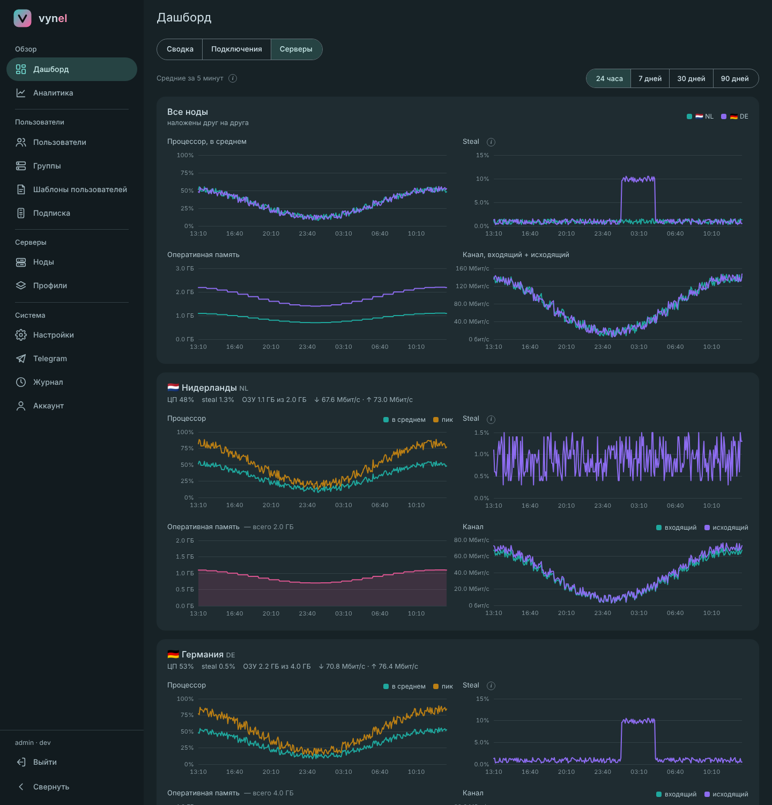
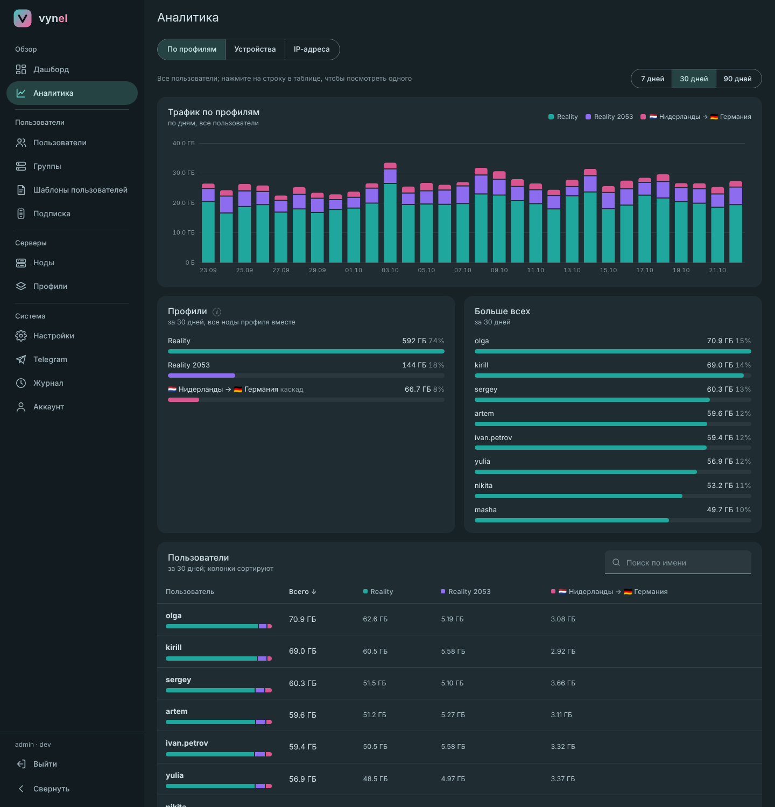

<div align="center">


# vynel

**Панель управления Xray: сервер, ноды, пользователи и подписки, устанавливаемые одной командой.**

VLESS Reality · XHTTP · Hysteria2 · один исполняемый файл · один домен · без Docker

[](https://github.com/vyto4ka/vynel/actions/workflows/ci.yml)
[](https://github.com/vyto4ka/vynel/releases)
[](go.mod)
[](https://github.com/XTLS/Xray-core)
[](https://nginx.org)
[](#требования)

[Установка](#установка) · [Руководство](https://raw.githack.com/vyto4ka/vynel/main/docs/guide.html) · [Обзор](#обзор) · [Возможности](#возможности) · [Требования](#требования) · [Потребление памяти](#потребление-памяти) · [Документация](#документация)

</div>

---

## Установка

Под root на сервере:

```bash
bash <(curl -fsSL https://github.com/vyto4ka/vynel/releases/latest/download/install.sh)
```

**[Пошаговое руководство →](https://raw.githack.com/vyto4ka/vynel/main/docs/guide.html)** — что подготовить, что значит каждый вопрос установщика, первое подключение и администрирование.

Заранее нужны сервер на Ubuntu 22.04+ или Debian 11+ и домен с A-записью на его IP. Перед установкой стоит проверить, что IP сервера не заблокирован: подключиться к нему по SSH напрямую, без обходов.

Установщик открывает форму в терминале: всё на одном сервере (рекомендуется для начала), только панель, только нода, обновление, защита сервера, удаление. Он ставит Xray и nginx, получает сертификат, включает файрвол и в конце печатает адрес панели и данные для входа.

Дальше — в панели: «Пользователи» → «Пользователь», и ссылка подписки открывается на устройстве. Рекомендуемый клиент — [KeqDroid](https://github.com/Lemonochka/keqdroid/releases/latest): он добавляет подписку одной кнопкой.

Отдельная панель и ноды, обновление, удаление, типичные проблемы — [INSTALL_GUIDE.md](docs/INSTALL_GUIDE.md).

Установка и обновления идут из [релизов](https://github.com/vyto4ka/vynel/releases): сервер получает новую версию, когда выпущен релиз, а не с каждым коммитом. Проверить свежий коммит на своём сервере до выпуска можно командой `vynel update --channel dev --ref main` ([как это устроено](docs/DEVELOPMENT.md#сборки-и-релизы)).

---

## Обзор

| Свойство | Описание |
|---|---|
| Установка одной командой | Панель, Xray, сертификат, сайт-заглушка и подписки работают на одном сервере с одним IP-адресом и одним доменом. Ручная настройка nginx, certbot и JSON-конфигов Xray не требуется. |
| Автоматическая сборка конфигурации | Профиль создаётся из шаблона; ключи Reality, shortId, SNI, пути и точки подключения генерируются для каждой ноды. Страна, флаг и название ноды определяются при подключении. |
| Маскировка | Reality перенаправляет посторонние подключения на собственный многостраничный сайт с действительным сертификатом. Запросы по IP или с чужим именем nginx отклоняет, не раскрывая домен. Панель находится по секретному пути, подписки неотличимы от обычных страниц, перебор токенов блокируется. |
| Несколько протоколов на одном сервере | VLESS Reality на TCP 443, Hysteria2 на UDP 443 и XHTTP на том же домене и том же сертификате, который продлевается автоматически. |
| Изменения без перезапуска | Пользователи добавляются, продлеваются и отключаются на нодах за секунды через API Xray, без разрыва соединений остальных пользователей. |
| Обновления из панели | Панель отслеживает новые версии. Команда «Обновить всё» обновляет ноды одновременно, а панель — последней; простой составляет около минуты. При неудачном запуске новой версии восстанавливается предыдущая. Изменения только документации и тестов обновлений не вызывают. |
| Управление нодами | Перезапуск Xray, nginx, службы или сервера, повторная отправка конфигурации — из меню ноды, без SSH. |
| Связь панели и нод | gRPC поверх взаимного TLS с собственным центром сертификации. Ноды подключаются к панели сами, порт открыт только их адресам. При потере связи статистика накапливается на ноде и передаётся без потерь. |
| Telegram-бот | Управление пользователями, вход в панель без пароля, ежедневные резервные копии, уведомления о недоступных нодах. |
| Защита сервера | Файрвол открывает только используемые порты; сканеры портов блокируются на сутки; SSH переводится на вход по ключу и другой порт с проверкой, исключающей потерю доступа. |
| Контроль входа | Три режима: пароль, только одноразовые ссылки (подбирать нечего, адрес панели может меняться для каждой сессии) или только Telegram Mini App. Сессия завершается после 5 минут бездействия, при смене IP и при закрытии вкладки; о каждом входе сообщает бот. |
| Диагностика | `vynel node diag` формирует отчёт о ноде (версии, сертификаты, порты, проверка сайта-заглушки) без ключей и UUID. |

---

## Скриншоты

<table>
<tr>
<td width="50%"><br><sub><b>Дашборд</b> — пользователи, онлайн, трафик, ноды, наличие новой версии</sub></td>
<td width="50%"><br><sub><b>Подключения</b> — трафик, онлайн, ноды, активность по часам</sub></td>
</tr>
<tr>
<td><br><sub><b>Серверы</b> — процессор, steal, память, канал каждой ноды и всех вместе</sub></td>
<td><br><sub><b>Аналитика</b> — трафик по профилям у каждого пользователя, все устройства и IP-адреса</sub></td>
</tr>
<tr>
<td><br><sub><b>Пользователи</b> — продление, устройства, ссылка подписки с QR-кодом</sub></td>
<td><br><sub><b>Ноды</b> — состояние, нагрузка, инбаунды, действия и обновление</sub></td>
</tr>
<tr>
<td><br><sub><b>Профили</b> — Reality, XHTTP, Hysteria2 на основе шаблонов</sub></td>
<td><br><sub><b>Подписка</b> — вид страницы, кнопки приложений, заголовки, маршруты, предпросмотр</sub></td>
</tr>
</table>

<details>
<summary><b>Страница подписки на телефоне, Telegram, вход</b></summary>
<br>
<table>
<tr>
<td width="28%"><br><sub>Страница подписки на телефоне</sub></td>
<td width="72%"><br><sub>Telegram-бот, резервные копии, уведомления о нодах</sub><br><br><br><sub>Вход в панель</sub></td>
</tr>
</table>
</details>

---

## Возможности

### Протоколы и маскировка

- **VLESS + Reality (self-steal)** — основной профиль: сервер выглядит как собственный сайт с действительным сертификатом.
- **VLESS + XHTTP + REALITY** — трафик похож на обычные HTTP-запросы к сайту; режимы `stream-up` и `packet-up`, совместимая разметка для клиентов на ядре Xray.
- **VLESS + XHTTP через CDN** — резервный вход на случай недоступности IP-адресов серверов. Директивы nginx из инструкции CDN вносятся в шаблон без изменений.
- **Hysteria2** — QUIC на UDP 443 рядом с Reality, на том же сертификате; подходит для мобильных сетей и каналов с потерями.
- TLS-отпечаток (fingerprint) задаётся в профиле. Собственные шаблоны создаются в панели с подсветкой синтаксиса, проверкой и предпросмотром.

### Пользователи и подписки

- Срок действия, лимит трафика с автоматическим сбросом (день, неделя, месяц), лимит устройств по HWID — общий или индивидуальный, с возможностью отключения для отдельного пользователя.
- **Лимит одновременных IP-адресов** (по умолчанию 3) по данным всех нод. Лишний адрес блокируется на нодах в течение нескольких секунд, а подписка с него сообщает о превышении лимита. Проверка серверов клиентом (пинг) и IPv4 с IPv6 одного устройства лимит не расходуют.
- **Маршрутизация в подписке**: российские сайты и адреса — напрямую через DNS Яндекса, остальной трафик — через туннель с DoH. Поддерживаются форматы Xray JSON (KeqDroid), Mihomo и sing-box; для отдельного профиля можно задать собственную конфигурацию клиента.
- **Каскады** — вход на одной ноде и выход через другую — и **внешние подписки** по ссылке. Выдаются группе или пользователю с индивидуальным сроком; повторяющиеся серверы в подписку не дублируются.
- **Одна ссылка** на пользователя, собственная или случайная. Формат выбирается по клиенту: ссылки, Clash/Mihomo, sing-box или Xray JSON.
- В браузере ссылка открывает **страницу подписки** в светлой или тёмной теме: QR-код, трафик, срок и кнопки добавления в приложения. Вид, цвет, тексты, объявление и заголовки для приложений настраиваются в панели.
- Группы определяют доступ к серверам, профилям и отдельным инбаундам. Шаблоны пользователей ускоряют создание.

### Ноды

- Новый сервер подключается одной командой, которую выдаёт панель («Ноды» → «Добавить сервер»); ход подключения отображается в контрольном списке: связь, конфигурация, DNS, сертификат.
- Действия из меню ноды: перезапуск Xray, nginx, службы, перезагрузка сервера, обновление.
- Несколько IP-адресов на сервере, вход и выход через разные адреса, автоматическое распределение портов между Xray и nginx: при общем порте 443 nginx распределяет соединения по SNI.
- Сертификаты Let's Encrypt получаются и продлеваются на ноде; каждая новая конфигурация nginx проверяется (`nginx -t`) до применения.
- BBR, fq и TCP Fast Open настраиваются автоматически.
- Пять встроенных сайтов-заглушек (облачное хранилище, дизайн-студия, документация, кофейня, блог) с несколькими страницами, адресами без `.html`, favicon, robots.txt и собственной страницей 404.

### Статистика

- Трафик за 24 часа, 7, 30 и 90 дней со сравнением с предыдущим периодом; онлайн; трафик по нодам; распределение активности по часам; самые активные пользователи; приложения и платформы устройств.
- Нагрузка серверов за срок до 90 дней: процессор, steal, оперативная память в гигабайтах, входящий и исходящий канал каждой ноды.
- Биллинг серверов: провайдеры с иконками и ссылками на кабинет, стоимость нод и сумма в месяц, напоминание об оплате в Telegram за 5 дней, лимит трафика провайдера — нода выключается за пару гигабайт до него и включается сама в день сброса.
- Аналитика: сколько трафика ушло через каждый профиль и каскад — всего и у каждого пользователя; все устройства по HWID и все IP-адреса, с которых подключались, с поиском.

### Telegram-бот и резервные копии

- Создание, продление и отключение пользователей из чата; карточка пользователя со ссылкой подписки.
- Вход в панель без пароля: кнопка «Панель» открывает её в Telegram, либо одноразовая ссылка со сроком действия в одну минуту. Вход по паролю можно отключить.
- Ежедневная резервная копия в Telegram, при необходимости зашифрованная паролем. Новая панель восстанавливается из неё одной командой, ноды переподключаются автоматически.
- Уведомление о недоступной ноде — одно сообщение, которое обновляется при изменении состояния.

### Интерфейс

- Компоненты Material 3 на палитре Catppuccin.
- Боковое меню сворачивается до панели с иконками; на телефоне открывается поверх страницы.
- Работает на телефоне и в Telegram Mini App; пояснения к полям — во всплывающих подсказках «i», на виду только короткие уточнения.

---

## Архитектура

```
                    ┌────────────────────────── сервер ───────────────────────────┐
 клиент ───────────►│ TCP :443  nginx: распределение по SNI без расшифровки       │
                    │            ├─ имя Reality ─► Xray: VLESS Reality / XHTTP    │
                    │            │                 ├─ клиент с ключом ────────────► интернет
 браузер ──────────►│            │                 └─ остальные ─────┐            │
                    │            └─ другие имена ────────────────────┤            │
                    │            nginx 127.0.0.1:8443 ◄──────────────┘            │
                    │             ├─ /s/<токен>  → подписка                       │
                    │             ├─ /<секрет>/  → веб-панель                     │
                    │             └─ остальное   → сайт-заглушка                  │
 клиент ───────────►│ UDP :443  Xray: Hysteria2 (тот же сертификат)               │
                    │ TCP :80   nginx: выпуск сертификата Let's Encrypt           │
                    │ vynel: панель, подписки, статистика, бот, агент ноды        │
                    └─────────────────────────────────────────────────────────────┘
                             ▲ gRPC + mTLS (:9443, доступен только адресам нод)
                             └──── другие ноды: vynel node + Xray + nginx
```

---

## Требования

| Параметр | Значение |
|---|---|
| Операционная система | Ubuntu 20.04+ или Debian 11+, `amd64` или `arm64` |
| Ресурсы | от 1 vCPU и 1 ГБ RAM (см. [потребление памяти](#потребление-памяти)) |
| Сеть | публичный IP-адрес, свободные TCP 80 и 443; для Hysteria2 — UDP 443 |
| Домен | домен с A-записью на сервер; для подписок и панели допускаются отдельные домены |
| Клиент | [KeqDroid](https://github.com/Lemonochka/keqdroid/releases/latest) — Android, Windows, Linux |

---

## Потребление памяти

Резидентная память (RSS) по результатам нагрузочных тестов: 4 ядра, Linux, Xray 26.3. Методика и полные результаты — в [DEVELOPMENT.md](docs/DEVELOPMENT.md#нагрузочные-тесты).

**Панель** (процесс `vynel panel`; 3 ноды, профили Reality и Hysteria2; нагрузка — 32 клиента, непрерывно запрашивающие подписки, 2 100–4 300 запросов в секунду):

| Пользователей | В простое | Пик под нагрузкой |
|---:|---:|---:|
| 1 000 | 34 МБ | 46 МБ |
| 5 000 | 40 МБ | 55 МБ |
| 20 000 | 53 МБ | 73 МБ |
| 50 000 | 76 МБ | 96 МБ |
| 100 000 | 116 МБ | 134 МБ |

**Нода** (Xray и агент `vynel node`; одно соединение на пользователя онлайн, каждое со своего адреса):

| Пользователей | Онлайн | Xray без соединений | Xray с соединениями | Агент |
|---:|---:|---:|---:|---:|
| 100 | 10 | 31 МБ | 37 МБ | 35 МБ |
| 1 000 | 100 | 32 МБ | 41 МБ | 35 МБ |
| 10 000 | 1 000 | 40 МБ | 88 МБ | 38 МБ |
| 10 000 | 3 000 | 39 МБ | 172 МБ | 41 МБ |
| 50 000 | 5 000 | 71 МБ | 291 МБ | 52 МБ |

Память Xray определяется в основном числом открытых соединений (около 45 КБ на соединение), а не числом пользователей; одно устройство обычно держит несколько соединений. При установке всего на одном сервере потребление складывается из панели, агента, Xray и nginx.

---

## Управление из терминала

```bash
vynel admin user add vasya                 # новый пользователь (срок и лимиты из шаблона)
vynel admin user show vasya                # ссылка подписки, трафик по нодам
vynel admin user extend vasya --months 1   # продление
vynel admin node list                      # ноды: состояние, нагрузка, проблемы
vynel admin web                            # адрес и логин веб-панели
vynel admin web mode link                  # вход только по одноразовым ссылкам (password | link | miniapp)
vynel update                               # обновление этого сервера (в фоне; --check — только сравнить версии)
vynel node diag > diag.txt                 # отчёт о ноде для диагностики
vynel firewall status                      # открытые порты и заблокированные сканеры
```

Обновлять удобнее из панели: уведомление на дашборде → «Обновить всё». Данные, ключи и пароль сохраняются.

---

## Документация

| Документ | Содержание |
|----------|-------|
| [Руководство](https://raw.githack.com/vyto4ka/vynel/main/docs/guide.html) ([исходник](docs/guide.html)) | Установка, первое подключение и администрирование — по вкладкам |
| [INSTALL_GUIDE.md](docs/INSTALL_GUIDE.md) | Установка: всё на одном сервере, отдельная панель, ноды; обновление, удаление, типичные проблемы |
| [USER_GUIDE.md](docs/USER_GUIDE.md) | Веб-панель, пользователи, группы, подписки, маршрутизация, каскады, HWID и лимит IP, статистика, ноды, Telegram, резервные копии, диагностика |
| [PROFILES.md](docs/PROFILES.md) | Шаблоны профилей: Reality self-steal, XHTTP через CDN, XHTTP + REALITY, Hysteria2 |
| [INBOUNDS.md](docs/INBOUNDS.md) | Инбаунды нод, наследование, несколько IP-адресов на сервере |
| [ARCHITECTURE.md](docs/ARCHITECTURE.md) | Устройство панели, нод и подписок |
| [DEVELOPMENT.md](docs/DEVELOPMENT.md) | Структура кода, сборка, тесты, нагрузочные тесты, релизы, добавление шаблонов |
| [ROADMAP.md](docs/ROADMAP.md) | Реализованное и планируемое |

<div align="center">
<br>
<sub>Построено на <a href="https://github.com/XTLS/Xray-core">Xray</a>, <a href="https://nginx.org">nginx</a>, Go и React.</sub>
</div>
